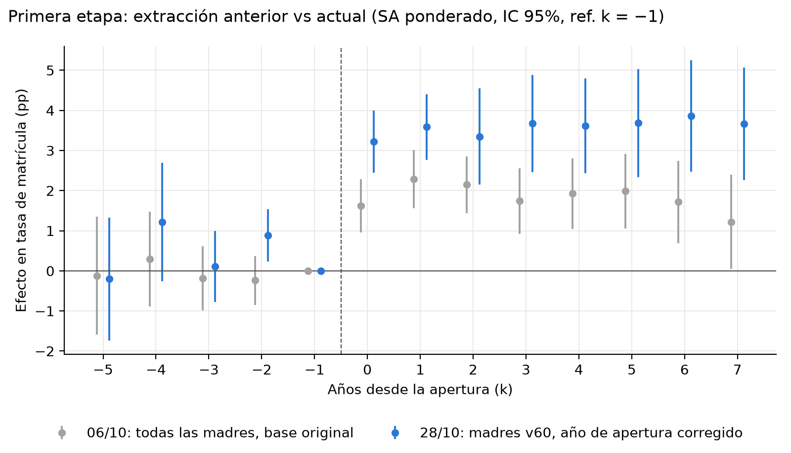
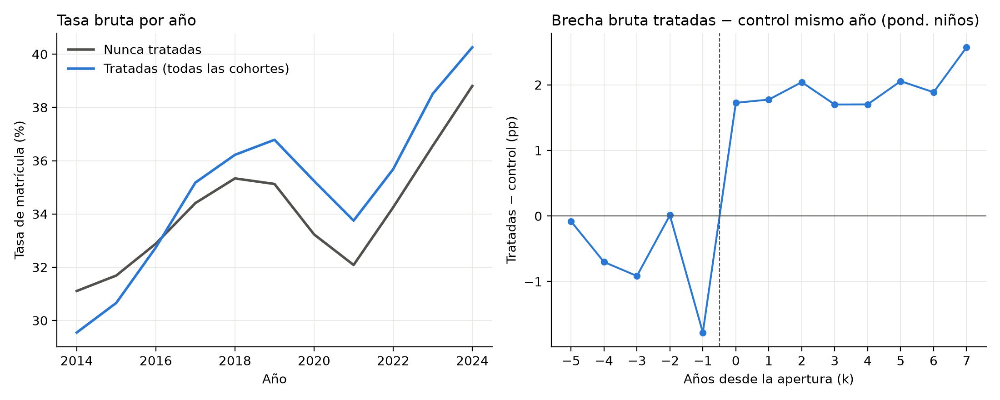
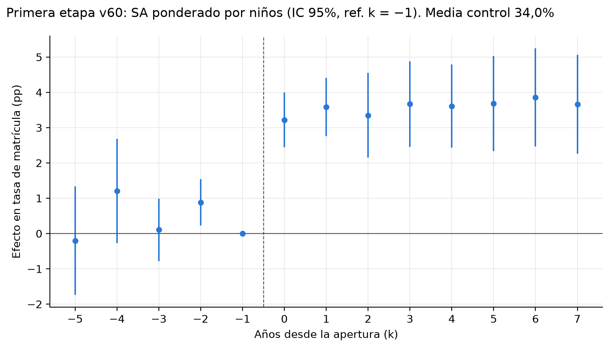
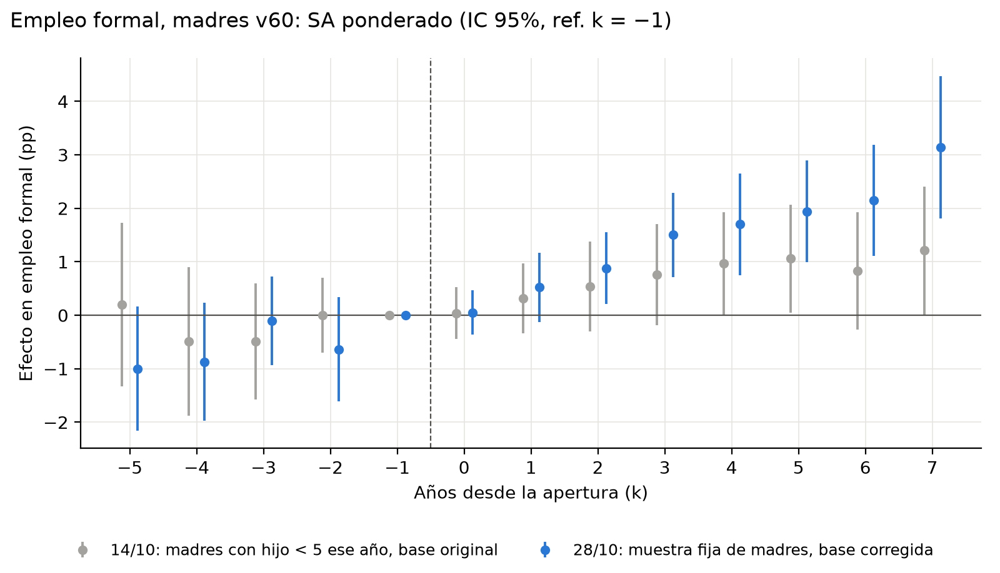
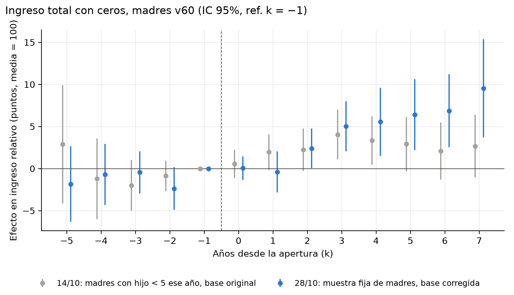
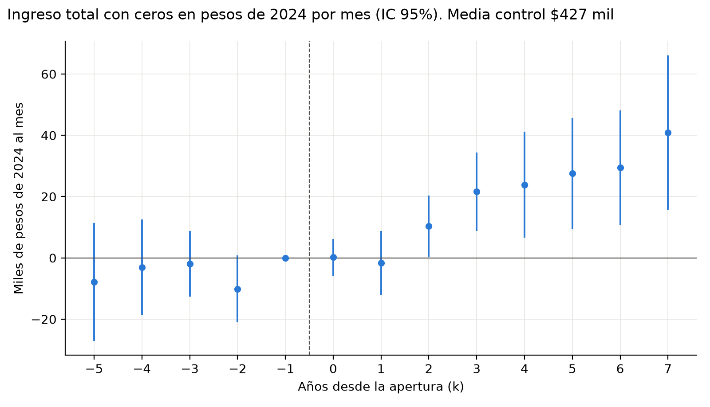
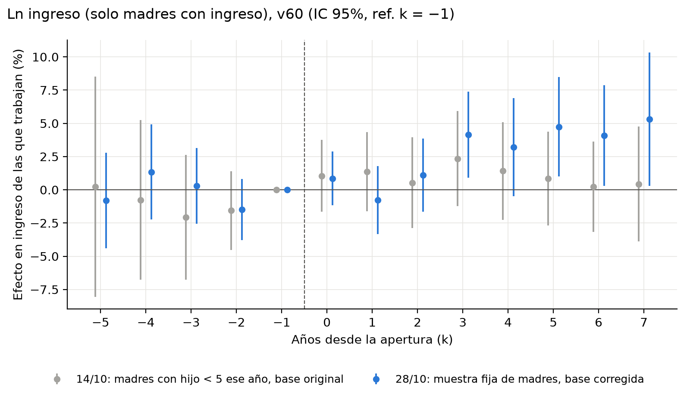
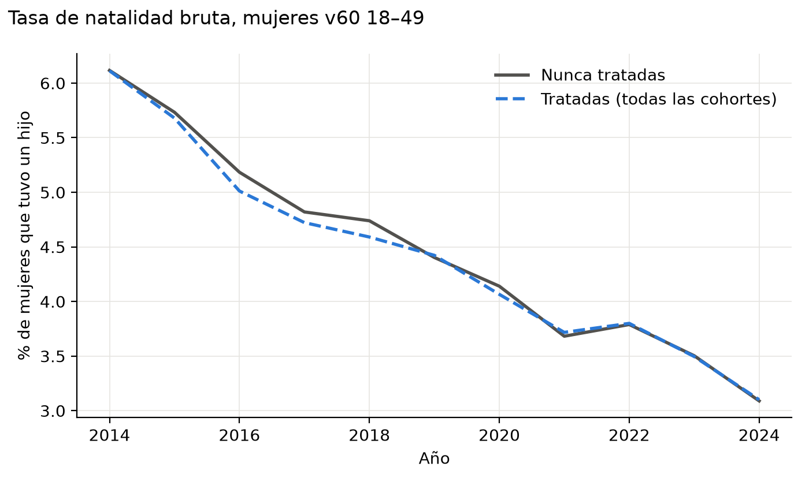
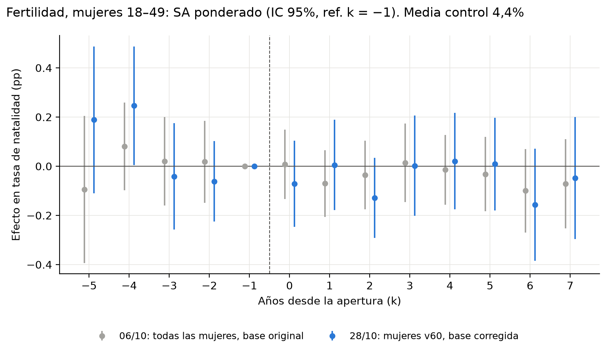
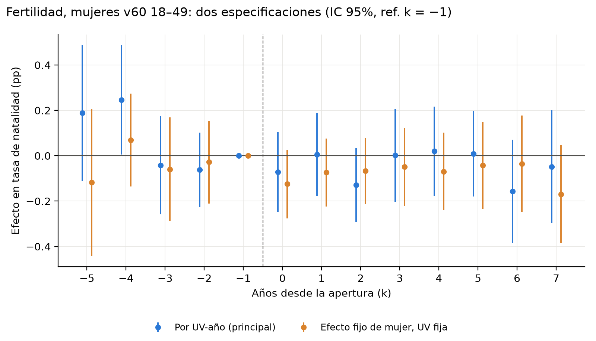

# Resumen extracción 28/10/2026

Base para la presentación. Cada sección termina con la idea principal (⇒).

---

## Guion: cómo decir cada resultado en palabras (reunión 29/10)

En el orden de la presentación. Las frases "si preguntan" no están en las diapos.

**Crosswalk (diapo 14).** "La base del RSH dice en qué UV vive cada mujer cada año, y los mapas dicen a qué UV de 2024 corresponde cada código. Antes de 2022 las dos fuentes no usan los mismos códigos; desde 2022 sí. Antes usaba dos métodos según el año (match fuzzy en unos años y seguir a los hogares en otros), y eso creaba un quiebre. Ahora uso un solo método para todos los años antes de 2022: cada código se asigna a la UV donde está la mayoría de sus hogares al año siguiente. Lo sigo revisando; lo ideal serían las equivalencias oficiales, pero el MDS no las tiene."
- *Si preguntan cómo se asigna:* "Por mayoría de hogares, año a año hacia atrás desde 2022."

**Arreglos de datos (diapo 15).** "Arreglamos tres cosas: el año de apertura de los jardines, el crosswalk de UV y la muestra laboral. Las dos primeras corrigen quién está tratado. Si una UV figura como tratada pero no le abrió nada, su efecto es cero y diluye el promedio. Por eso, al corregirlo, los efectos suben."
- *Si preguntan cuánto diluía:* "Como idea gruesa: si 128 de las 447 tratadas tenían efecto cero, el promedio salía en ~70% del efecto real (319/447). Es solo una aproximación, porque la estimación pondera por niños y cohorte."

**Primera etapa (diapo 16).** "Antes de abrir, las UV tratadas tenían 31% de matrícula y las control 33%. Cuando abre un jardín nuevo, la tasa de matrícula de los hijos de 0 a 4 años de madres vulnerables sube 3,6 puntos sobre una media control de 34%: alrededor de un 10% más. Sube el mismo año en que abre y se mantiene. En niños, son unos 5 niños más matriculados por UV. Es el doble de lo que teníamos antes de arreglar los datos."
- *Si preguntan por la cohorte 2015:* "Sacarla ya no cambia nada (3,58 con y sin ella). Antes sí cambiaba, porque estaba llena de UV que no eran realmente tratadas."
- *Si preguntan por qué se compara con 34% y no con 31%:* "El efecto se compara con el control porque representa lo que habría pasado sin jardín. Es la convención."

**Por qué la primera etapa sigue siendo chica (diapo 17).** "Ya revisamos el año de apertura, el crosswalk, la muestra vulnerable y un grupo control más limpio. Nuestro outcome mide si los niños que viven en la UV están matriculados en cualquier jardín, o sea un cambio neto. Un jardín nuevo puede llenarse con niños que ya iban a otro jardín y se cambian al más cercano: eso no mueve la matrícula neta, pero sí le ahorra tiempo a la madre."

**k = −2 (anexo A6, solo si preguntan).** "Los pre-años no son significativos, salvo k = −2, que queda casi un punto por encima del año de referencia. Es un punto suelto que viene de las cohortes más nuevas, y aun en el peor caso el efecto sería de unos 2,7 puntos. Lo vamos a revisar con HonestDiD."
- *Recordar:* k = −1 siempre vale 0 porque es la referencia. Un k = −2 positivo solo dice que la brecha en k = −2 era más alta que en k = −1. No se sabe si k = −2 fue alto o k = −1 bajo, pero como k = −3 y k = −5 están al nivel de k = −1, parece un punto alto suelto.

**Gráficos de niveles de primera etapa (anexo A5, solo si preguntan).** "El de la izquierda muestra la matrícula sin modelo: las tratadas parten más abajo y terminan más arriba. El de la derecha es la resta tratadas − control según años desde la apertura: un event study hecho a mano, donde el salto en k = 0 se ve en los datos crudos."

**Empleo (diapo 18).** "Tratadas y control parten con el mismo empleo formal, cerca de 52%. El año en que abre el jardín no cambia nada, pero desde el segundo año empieza a subir. En los primeros cinco años el aumento promedio es de casi un punto, unas 2 madres más trabajando por UV. Cuenta a todas las madres de la UV, usen o no el jardín."
- *Si preguntan por qué hay más madres que niños:* "La matrícula es una foto de cada año, porque los niños salen a los 5. El empleo se acumula: una madre que volvió a trabajar sigue trabajando y sigue en la muestra."
- *Si preguntan si k = 0–4 es "mientras el hijo tiene menos de 5":* "No exactamente. k son años desde la apertura; en la muestra fija hay madres con hijos de distintas edades en k = 0. Es la ventana en que un hijo nacido cerca de la apertura puede usar el jardín."

**Pre-tendencias en empleo (diapo 19).** "Los coeficientes previos son levemente negativos. Eso significa que, antes de la apertura, el empleo de las tratadas venía subiendo un poco más rápido que el del control. Pero pre y post vienen de cohortes distintas. Si miro cada cohorte por separado, en 2016 y 2017, las más grandes con años previos, el empleo no venía subiendo antes de abrir: el aumento empieza después. Los pre negativos vienen de las cohortes 2020–2024, que son chicas y ruidosas."

**Niveles de ingreso (diapo 20).** "Cerca de la mitad de las madres vulnerables no tiene ingreso formal en un año dado. Las que trabajan ganan unos 770 mil pesos al mes en 2024. Los montos están en pesos de 2024."
- *Si preguntan por el crecimiento del ingreso en el tiempo:* "Cualquier cosa nacional, como la inflación, el crecimiento de salarios o un cambio en la medición, le pasa igual a tratadas y control, y los efectos fijos de año la eliminan. Solo importa para describir los niveles, no para el efecto."

**Ingreso de las que trabajan (diapo 21).** "Las madres que trabajan en UV tratadas y control ganan lo mismo al partir. En los primeros cinco años, las que trabajan ganan en promedio 1,7% más, unos 14 mil pesos, y se ve más claro desde el tercer año."
- *Recordar:* en k = 0–4 solo k = 3 es significativo por separado. Es el resultado más débil.

**Ingreso contando ceros (diapo 22).** "Tratadas y control parten con ingresos parecidos. En los primeros cinco años después de la apertura, el ingreso promedio de las madres de la UV, contando como cero a las que no trabajan, sube unos 11 mil pesos al mes, alrededor de 2,5%. Es significativo desde el segundo año y no hay pre-tendencias."
- *Números:* k 0–4 = +$10.870 (EE 4.396); k 0–7 = +$19.023 (EE 6.053). En relativo (anexo A7): +2,5 pts (EE 1,0) y +4,4 (EE 1,4). Es la misma estimación en otra escala.
- *Si preguntan por qué antes era 19k:* "Ese era el promedio de los 8 años post. En los primeros cinco es menor porque el efecto crece con el tiempo."

**De dónde viene el aumento (diapo 23).** "El ingreso promedio es el porcentaje que trabaja por lo que ganan las que trabajan. Si descompongo los 11 mil, más o menos la mitad viene de que más madres trabajan y la otra mitad de que las que ya trabajaban ganan algo más. Lo segundo sería consistente con madres que cambian a su hijo a un jardín más cercano: no cambia la matrícula, pero ahorran tiempo y pueden trabajar más horas o en mejores trabajos."

**Fertilidad, las dos estimaciones (diapo 24).** "Estimamos el efecto en natalidad de dos formas: a nivel UV-año, como en los resultados laborales, y comparando a cada mujer consigo misma con efecto fijo de mujer, tratada según su primera UV. Las dos dan lo mismo: en los primeros cinco años el efecto es cero. Con efecto fijo de mujer desaparecen además los pre-años algo positivos."

**Niveles de fertilidad (diapo 25).** "Tratadas y control parten con la misma natalidad, 6%, y caen exactamente igual hasta 3%: es la caída de la fecundidad en Chile."
- *Si preguntan por k = −5 y −4 positivos:* "Solo los aportan las cohortes de 2018 en adelante, y el test conjunto no rechaza (p ≈ 0,11)."

**Efecto fijo de mujer (diapo 26).** "Cada mujer se compara consigo misma antes y después de la apertura, y queda asignada a su primera UV aunque se mude. El panel balanceado de madres retiene un 79% de las de 2014, parecido en tratadas y control. En fertilidad da cero; los resultados laborales están estimados y llegan la próxima semana."

---

## 0. Mejoras en la base de datos desde la extracción anterior

### 0.1 Año de apertura de los jardines (afecta todo)

- **Problema:** en la base de JUNJI, muchos jardines tenían como fecha de inicio el **1 de marzo de 2015**, una fecha por defecto que se asignaba a jardines que ya existían. Por eso aparecían como "abiertos en 2015" jardines que llevaban años funcionando.
- **Arreglo:** el año de apertura se tomó de los **paneles anuales de establecimientos obtenidos por transparencia**: el primer año en que el jardín aparece en los registros.
- **Resultado:** la cohorte 2015 baja de **179 a 51 UV**, y el total de UV tratadas de **447 a 319**. Se sacaron 128 UV que eran tratadas falsas.
- **Por qué afecta tanto:** en esas 128 UV no abrió nada nuevo, así que su matrícula, empleo e ingreso no cambian "después de la apertura". Al tratarlas como tratadas, el efecto promedio se mezclaba con ceros. Si ~29% de las tratadas no lo son (128 de 447), el efecto estimado es cerca de un 71% del verdadero. Solo con eso, corregirlo sube el efecto ~1,4 veces.

### 0.2 Crosswalk de unidades vecinales (afecta todo)

- **Problema:** para seguir a las personas entre años, los códigos de UV de cada año del RSH se traducen a las UV de 2024. Antes, los códigos de 2017, 2020 y 2021 se trataban como "verdaderos" y se unían directo, aunque esos años usaban otro sistema de códigos. Resultado: entre 2021 y 2022, **UVs enteras "se mudaban"** (23,6% de las personas cambiaba de UV; en 122 UVs se mudaba el 90–100%).
- **Arreglo:** unión directa solo para 2022–2024, años en que el código cartográfico es confiable. Para 2021 hacia atrás, el código antiguo se asigna a la UV 2024 donde vive la mayoría de esas personas al año siguiente ("votación"), un año a la vez.
- **Resultado:** desaparecen las UV enteras que se mudaban (de 122 a 7 UVs con 90–100% de mudanza).
- **Por qué afecta tanto:** si una persona queda en la UV equivocada, también queda con el tratamiento equivocado: una madre de una UV con jardín nuevo podía quedar contada como control, y al revés. Eso también acerca el efecto a cero.

⇒ **Los dos arreglos corrigen errores en quién está tratado. Ese tipo de error siempre empuja el efecto hacia cero, y por eso al corregirlo los efectos suben.** En primera etapa, el efecto se duplica (+1,8 → +3,6 pp), más que el ~1,4 que explicaría solo el año de apertura: el resto viene del crosswalk. La muestra v60 casi no mueve el resultado (revisado en el RIS).

### 0.3 Cambios en la muestra y variables laborales

| Cambio | Antes | Ahora | Por qué importa |
|---|---|---|---|
| **Muestra fija de madres** | Mujer-año con hijo < 5 **ese año**: la madre sale cuando su hijo cumple 5 | La madre entra el primer año con hijo < 5 y se queda hasta 2024 | Permite ver si el efecto dura después de que el hijo sale del jardín. Antes, las madres que más tiempo llevaban expuestas salían justo de la muestra |
| **Vulnerabilidad (v60)** | Solo RSH desde 2016: las mujeres vistas solo en 2014–15 quedaban fuera | FPS en 2014–15 + RSH desde 2016 | No se pierden madres por falta de dato |
| **Ingreso** | Solo renta imponible, que no incluye el ingreso independiente | Renta + ingreso independiente | Mide el ingreso completo; puede explicar que ahora sí haya efecto en el ingreso de las que trabajan |
| **Ingreso en pesos** | Solo relativo (media = 100) | También en pesos de 2024 al mes | Magnitudes en plata |

---

## 1. Primera etapa: matrícula parvularia

**Qué se estima:** tasa de matrícula de los hijos de 0 a 4 años de madres del 60% más vulnerable, a nivel UV-año. Sun-Abraham ponderado por número de niños, control = UV nunca tratadas, referencia k = −1.

### 1.1 Qué cambió desde la extracción anterior

| | 06/10 | 14/10 | 28/10 (ahora) |
|---|---|---|---|
| Muestra | Todas las madres | Todas las madres | **Madres v60** |
| Año de apertura de los jardines | Base original | Base original | **Corregido con paneles anuales de transparencia** |
| Cohorte 2015 | 179 UV | Excluida | **51 UV** |
| UV tratadas | 447 | — | **319** |
| Crosswalk de UV | Original | Original | **Corregido** (match directo solo 2022–2024, votación hacia atrás 2021 → 2016) |
| Efecto promedio k 0–7 | +1,8 pp | +2,7 pp | **+3,6 pp** |

- El efecto pasa de ~2 pp a ~3,6 pp en todos los años post, y los intervalos ya no se superponen desde k = 3.
- El k = −2 era −0,2 pp en la extracción anterior y ahora es +0,9 pp: la caída del año previo a la apertura apareció con los cambios de esta semana (ver 1.4).
- La corrección del año de apertura sacó 128 UV que figuraban como "abiertas en 2015" pero cuyo jardín ya existía. Eran tratadas falsas: no cambiaban nada y diluían el efecto. Con la corrección, sacar la cohorte 2015 ya no cambia el resultado.
- Pasar a la muestra v60 casi no mueve el resultado (revisado en el RIS): **el aumento de +1,8 a +3,6 pp viene casi entero del arreglo de los datos** (año de apertura y crosswalk).
- Nuevo en esta extracción: matriz de varianzas (V), que permite calcular el error estándar del promedio y un test conjunto de pre-tendencias.

### 1.2 Niveles antes de la apertura

| Tasa de matrícula | Tratadas | Control | Brecha |
|---|---|---|---|
| 2014 | 29,5% | 31,1% | −1,6 pp |
| Promedio años antes de abrir | 31,7% | 32,6% | −0,9 pp |
| Año antes de abrir (k = −1) | 31,3% | 33,1% | −1,8 pp |
| Promedio años después de abrir | 36,6% | 34,8% | +1,8 pp |

**Cómo leer cada gráfico** (en la presentación quedaron en el anexo A5):
- **Izquierdo, "tasa de matrícula bruta":** es la tasa promedio de cada año calendario, sin modelo, con una línea para el control y otra para todas las tratadas juntas. *Conclusión:* las tratadas parten más abajo y terminan más arriba que el control, y las dos líneas suben con el tiempo y caen igual en 2020–21 (COVID).
- **Derecho, "brecha bruta tratadas − control":** es la resta tratadas − control en el mismo año, ordenada por años desde la apertura (k). Funciona como un event study hecho a mano, sin modelo. *Conclusión:* la brecha es negativa antes de abrir y salta hacia arriba en k = 0. El salto se ve en los datos crudos, así que no lo inventa el estimador.
- **Para qué sirven:** son respaldo por si alguien duda del event study. El mensaje es el mismo de la diapo principal.

⇒ Las UV tratadas parten 1–2 puntos **por debajo** del control (los jardines abren donde hay menos matrícula) y terminan ~2 puntos **por encima**. El DiD no requiere niveles iguales, solo tendencias paralelas.

### 1.3 Resultado principal

- **Cómo decirlo en la reunión:** "Cuando abre un jardín nuevo en una UV, la tasa de matrícula de los hijos de 0 a 4 años de madres vulnerables sube 3,6 puntos, de 34% a cerca de 38%: alrededor de un 10% más. Sube el mismo año en que abre y se mantiene. En niños, son unos 5 niños más matriculados por UV."
- **+3,6 pp** promedio k 0–7 (EE 0,47), sobre una media control de 34,0% ⇒ **≈ +10%**.
- Salta el mismo año de apertura (+3,2 pp en k = 0) y se mantiene estable en ~3,5 pp todos los años siguientes.
- En niños: una UV tratada tiene en promedio ~143 niños de 0–4 años hijos de madres v60 ⇒ 0,036 × 143 ≈ **5 niños v60 más matriculados por UV**. Sigue siendo poco frente a los cupos de un jardín nuevo (decenas). Solo cuenta hijos de madres v60: el total, incluyendo al 40% restante, puede ser mayor.
- Se muestra hasta k = 7: k = 8 y 9 solo los aportan las cohortes 2015–2016 (k = 9 = solo 51 UV de 2015), con intervalos muy anchos.

⇒ **La primera etapa es clara, inmediata y estable, y más grande que antes (+3,6 pp vs +1,8 pp), pero sigue siendo chica en número de niños (~5 por UV).**

### 1.4 Pre-tendencias: el k = −2

- Los pre en k = −5, −4 y −3 son cero. **k = −2 = +0,9 pp, significativo** (t = 2,6). El test conjunto de los 4 pre rechaza al 5% (χ²(4) = 12,2, p ≈ 0,02).
- Qué significa: todo se mide contra k = −1, que siempre vale 0 porque es la referencia y no se estima. Un k = −2 = +0,9 dice solo que **dos años antes de abrir, la brecha tratadas − control era 0,9 puntos más alta que un año antes de abrir**. Con ese punto solo no se sabe si k = −2 fue un año "alto" o k = −1 un año "bajo".
- Mirando los otros pre: k = −3 (+0,1) y k = −5 (−0,2) están al mismo nivel que k = −1, y k = −4 (+1,2) no es significativo. Los pre suben y bajan, así que **es un punto suelto, no una tendencia**.
- Si k = −1 hubiera sido un año anormalmente bajo, medir contra él inflaría el efecto. En el peor caso, midiendo contra k = −2, el efecto sería ~3,6 − 0,9 ≈ **2,7 pp**: sigue siendo positivo y grande.
- **Cómo decirlo si preguntan (está en el anexo A6):** "Los pre-años no son significativos, salvo k = −2, que queda casi un punto por encima del año de referencia. Es un punto suelto que viene de las cohortes más nuevas, y aun en el peor caso el efecto sería de unos 2,7 puntos. Lo vamos a revisar con HonestDiD."
- Por cohorte (brecha bruta tratadas − control, cambio de k = −2 a k = −1):
  - 2016 y 2017 (las cohortes más grandes): sin cambio (−0,2 y −0,1 pp).
  - 2018–2023: caídas de −1 a −4 pp. Ahí se origina el k = −2.
- **No es COVID:** tratadas y control caen lo mismo en 2020–21 (−3,0 pp ambos), y la caída también aparece en cohortes cuyo año previo es 2017–2019.
- Tamaño: 0,9 pp ≈ un cuarto del efecto.
- **Es nuevo:** en la extracción del 06/10 el k = −2 era −0,2 pp (plano). Apareció con el arreglo de los datos (año de apertura corregido y crosswalk nuevo); la muestra v60 casi no mueve los resultados.

⇒ **Hay un pre-año que se sale (k = −2) en las cohortes más nuevas, del tamaño de un cuarto del efecto y todavía sin explicación.** Siguiente paso: análisis de sensibilidad (HonestDiD) para ver cuánto resiste el efecto a violaciones de ese tamaño.

### 1.5 Pendientes de esta sección

- Panel balanceado (`sa_w_bal`): 199 UV, N = 1.273, el efecto se va a 0 desde k = 2. No interpretable hasta ver cómo está definido en el 03 (no vino en la extracción).
- Número de niños por año (~250–275 mil) menor al esperado: confirmar si el 03 restringe a `muestra_t1`.
- HonestDiD con la V del modelo principal.

---

## 2. Resultados laborales: madres v60, muestra fija

**Qué se estima:** outcomes de las madres del 60% más vulnerable, colapsados a UV-año. Sun-Abraham ponderado por número de madres, control por edad, EF de UV y año, control = UV nunca tratadas, referencia k = −1.

### 2.1 Qué cambió desde la extracción anterior (14/10)

| | 14/10 | 28/10 (ahora) |
|---|---|---|
| Madres | Mujer-año con hijo < 5 **ese año** | **Muestra fija**: entra el primer año con hijo < 5 y se queda hasta 2024 |
| Vulnerabilidad (v60) | Solo RSH desde 2016 | FPS 2014–15 + RSH desde 2016 |
| Ingreso | Solo renta imponible | Renta + ingreso independiente |
| Año de apertura y crosswalk | Originales | Corregidos |

### 2.2 Empleo formal

**Qué mide:** el porcentaje de madres v60 de la UV con ingreso formal en el año. El coeficiente compara cuánto cambia ese porcentaje en las UV donde abrió un jardín respecto de las UV sin jardín, antes y después de la apertura. Es el efecto de **que abra un jardín en la UV** (intención de tratar), no el efecto de que una madre use el jardín.

**Niveles de partida** (brecha bruta de `tend_lab_v60fija`, ponderada por madres):

| % madres con ingreso formal | Tratadas | Control |
|---|---|---|
| 2014 | 50,5% | 50,1% |
| Año antes de abrir (k = −1) | 52,5% | 51,8% |
| Promedio años después de abrir | 54,5% | 53,5% |

⇒ A diferencia de la matrícula, en empleo tratadas y control **parten casi iguales** (~52%).

**Lo que se muestra en la diapo: los primeros 5 años (k = 0–4).** Es lo que interesa: el efecto del jardín mientras los hijos tienen edad de usarlo.
- Coeficientes: k0 = 0,05, k1 = 0,5, k2 = 0,9, k3 = 1,5, k4 = 1,7 pp. Significativo desde k = 2.
- Promedio k 0–4: **+0,9 pp** ≈ +2% ⇒ 0,009 × 230 ≈ **2 madres más trabajando por UV**.
- Ojo: no hay error estándar del promedio porque falta la V correcta. Los k = 2, 3 y 4 son significativos por separado.
- Ojo si preguntan: k son años desde la apertura, no la edad del hijo. En la muestra fija, en k = 0 hay madres con hijos de distintas edades. k = 0–4 es la ventana en que un hijo nacido cerca de la apertura puede usar el jardín.

**Resultado completo (k 0–7, no se destaca en la diapo):**
- **+1,5 pp** en promedio entre k = 0 y 7 (antes: +0,7 pp), sobre una media control de 52,9% ⇒ **≈ +3%**.
- **Efecto gradual:** 0 en la apertura, empieza en k = 2–3 y llega a **+3,1 pp en k = 7** (≈ +6%).
- En madres: una UV tratada tiene ~230 madres v60 ⇒ en promedio **~3 madres más trabajando por UV**, y **~7 a los 7 años**.
- Por qué tiene sentido que sea gradual: la matrícula sube de inmediato, pero encontrar trabajo formal toma tiempo; las madres con recién nacidos al abrir el jardín recién lo usan cuando el hijo tiene 2–3 años; y en la muestra fija cada año se suman madres expuestas, así que el efecto se acumula.

**Cómo se interpreta:**
- Se cuenta a **todas** las madres v60 de la UV, también a las que nunca usaron el jardín. El efecto de las que sí lo usan queda diluido entre todas; por eso el número es chico.
- **Decirlo solo si preguntan** ("¿por qué más madres que niños?"). Relación con la primera etapa (~5 niños v60 más matriculados por UV): la matrícula es una foto de cada año (los niños salen al cumplir 5), mientras que el empleo se acumula: una madre que volvió a trabajar sigue trabajando después de que su hijo sale del jardín, y sigue en la muestra fija. Por eso la matrícula se ve plana y el empleo crece.
- Lectura: el jardín ayuda a las madres a volver a trabajar, y ese empleo dura (supone que la tendencia previa no explica el aumento; ver abajo).

⇒ **Que abra un jardín aumenta de forma gradual el empleo formal de las madres vulnerables de la UV: ~2 madres más trabajando por UV en los primeros 5 años (~3 en promedio k 0–7).**

**Cómo decirlo en la reunión:** "Tratadas y control parten con el mismo empleo formal, cerca de 52%. El año en que abre el jardín no cambia nada, pero desde el segundo año empieza a subir. En los primeros cinco años el aumento promedio es de casi un punto, unas 2 madres más trabajando por UV. Cuenta a todas las madres de la UV, usen o no el jardín."

**Pre-tendencias:**
- Los coeficientes previos son levemente negativos (−1,0, −0,9, −0,1, −0,6 pp; ninguno significativo por sí solo). Visto de corrido, el gráfico parece una sola línea que sube desde k = −5.
- Pero los pre y los post **no vienen de las mismas cohortes**: k = −5 solo lo aportan las aperturas de 2019 en adelante, y k = 5–7 solo las de 2015–2017. La "línea" junta cohortes distintas.
- Dentro de cada cohorte (brecha bruta tratadas − control):
  - **2016 y 2017** (las cohortes grandes con años pre): no venían subiendo; 2016 plana y 2017 incluso bajando. Después de la apertura suben ~3 pp de a poco.
  - **2015**: sube igual, pero tiene un solo año pre.
  - **2020–2024** (las que forman los pre lejanos): chicas y muy ruidosas; de ahí salen los pre negativos.

⇒ **En las cohortes con más seguimiento no hay tendencia previa al alza: el aumento empieza después de la apertura.** Falta el test formal.

**Pendientes:**
- Test conjunto de pre-tendencias y sensibilidad (HonestDiD): falta la V correcta del modelo principal (se extrajo una antigua).
- Event study balanceado en tiempo relativo (solo cohortes observadas en toda la ventana), para que pre y post vengan de las mismas UV.
- EF de mujer con mujeres balanceadas (08a), para descartar sesgo de ciclo de vida.

### 2.3 Ingreso

**Niveles de ingreso de las madres v60 (muestra fija, todas las UV)**

Ingreso anual total dividido por 12, en pesos de cada año (nominal). "Con ingreso" = tiene algún ingreso formal en el año.

| Año | Madres | % con ingreso | Promedio todas (con ceros) | Promedio las que trabajan | Mediana las que trabajan |
|---|---|---|---|---|---|
| 2014 | 242.897 | 50% | $154 mil | $308 mil | $231 mil |
| 2015 | 289.790 | 52% | $175 mil | $338 mil | $254 mil |
| 2016 | 333.493 | 52% | $190 mil | $367 mil | $276 mil |
| 2017 | 362.908 | 51% | $202 mil | $394 mil | $303 mil |
| 2018 | 394.208 | 52% | $217 mil | $416 mil | $323 mil |
| 2019 | 417.096 | 52% | $237 mil | $454 mil | $361 mil |
| 2020 | 457.404 | 49% | $235 mil | $479 mil | $386 mil |
| 2021 | 500.211 | 53% | $279 mil | $529 mil | $418 mil |
| 2022 | 541.063 | 57% | $336 mil | $591 mil | $471 mil |
| 2023 | 556.068 | 56% | $386 mil | $695 mil | $562 mil |
| 2024 | 565.324 | 56% | $429 mil | $769 mil | $631 mil |

**En pesos de 2024 (los que van en la diapo)**, deflactados con el IPC promedio anual. El factor es **aproximado, de memoria: verificar con la serie del INE o del Banco Central** antes de usarlo en un documento final.

| Año | Factor a 2024 | Promedio todas (con ceros) | Promedio las que trabajan |
|---|---|---|---|
| 2014 | 1,56 | $241 mil | $481 mil |
| 2016 | 1,44 | $274 mil | $530 mil |
| 2018 | 1,38 | $299 mil | $574 mil |
| 2020 | 1,31 | $308 mil | $627 mil |
| 2022 | 1,12 | $377 mil | $663 mil |
| 2024 | 1,00 | $429 mil | $769 mil |

- Aun en pesos reales, el ingreso de las que trabajan sube ~60% en 10 años. Parte de eso viene de que es una muestra fija: las madres envejecen y ganan experiencia, y entran madres nuevas.
- Ojo: el salto 2022 → 2024 es grande incluso en pesos reales (+16%). Revisar si algo cambia en la medición del ingreso esos años.

- La muestra crece cada año porque es fija: entran madres nuevas y ninguna sale.
- Cerca de la mitad de las madres vulnerables tiene ingreso formal; sube de 50% a 56% en el período, con una caída en 2020 (COVID).
- Las que trabajan ganan en promedio $769 mil al mes en 2024 (mediana $631 mil). Es un promedio anual dividido por 12: una madre que trabajó solo parte del año aparece con menos.

⇒ **La mitad de las madres vulnerables no tiene ingreso formal en un año dado; las que trabajan ganan ~$770 mil al mes en 2024.**

**Efectos**

Tres outcomes, todos con la misma estimación (SA ponderado por madres). Las pre-tendencias del ingreso con ceros están bien: test conjunto χ²(4) = 3,7, p ≈ 0,45.

**a) Ingreso con ceros, relativo (media = 100)**

- Eje y: cada año, el ingreso de cada madre como % del ingreso promedio de todas las madres ese año. 100 = madre promedio, 0 = no trabaja.
- Un coeficiente de +5 = el ingreso de las madres de UV tratadas subió 5% del ingreso promedio más que en las UV control.
- Promedio k 0–7: **+4,4 puntos** (EE 1,4) ⇒ ≈ +4,4%. **k = 7: +9,5 puntos** ⇒ siete años después de abrir, las madres de la UV ganan en promedio ~10% más que sin jardín.
- Antes (14/10): +2,5 puntos.

⇒ **El ingreso promedio de las madres de la UV sube de a poco y llega a ~10% más a los 7 años.**

**b) Ingreso con ceros en pesos de 2024 al mes**

- Mismo gráfico en plata: ingreso por madre al mes, contando con $0 a las que no trabajan. "Pesos de 2024" = cada año llevado al nivel del ingreso promedio de 2024. Media control: $427.000.
- Promedio k 0–7: **+$19.000 al mes por madre** (EE 6.000). **k = 7: +$41.000.**
- En la UV completa (~230 madres): ~$4,4 millones más al mes en promedio, ~$8,8 millones a los 7 años.

⇒ **Cada madre de la UV gana en promedio ~$19.000 más al mes, y ~$41.000 a los 7 años.**

**c) Ln ingreso (solo madres con ingreso)**

- Eje y: % de cambio en el ingreso de las madres que trabajan (las que no trabajan no entran).
- Promedio k 0–7: **+2,8%**. **k = 7: +5,3%** ⇒ unos $43.000 más al mes sobre un sueldo promedio de ~$807.000.
- Antes (14/10): +1,0%, no significativo. Ahora se suma el ingreso independiente y la muestra fija sigue a las madres por más años.
- Selección: si las que entran a trabajar gracias al jardín ganan menos que el promedio, bajan este número; el aumento para las que ya trabajaban podría ser mayor.

⇒ **Las madres que trabajan también ganan más (~5% a los 7 años).**

**De dónde viene el aumento**

Ingreso promedio = (% que trabaja) × (sueldo de las que trabajan). Media control $427.000 = 0,529 × ~$807.000.

| Parte | Cuenta | Monto |
|---|---|---|
| Más madres trabajando | +0,015 × $807.000 | ≈ $12.000 |
| Las que trabajan ganan más | 0,529 × 2,8% × $807.000 | ≈ $12.000 |
| Suma / estimado directo | | ≈ $24.000 / $19.000 |

- La primera parte está sobrestimada (las que entran a trabajar probablemente ganan menos que $807.000), así que una parte importante viene de que las que ya trabajaban ganan más.
- **Posible explicación del margen intensivo:** la primera etapa mide matrícula *neta* (~5 niños más). Pero muchas madres probablemente **cambian a su hijo de un jardín lejano al nuevo, más cerca de la casa**: no suman matrícula, pero ahorran tiempo de traslado y pueden trabajar más horas o tomar mejores trabajos. (Hipótesis, por comprobar: matrícula en el jardín nuevo de niños que antes estaban en otro jardín.)

### 2.4 Conclusión: efecto de los jardines en ingresos

**Lo que va en la diapo: los primeros 5 años (k = 0–4)**, mientras los hijos tienen edad de usar el jardín:

| | Nivel de partida (2014) | Promedio k 0–4 | Detalle |
|---|---|---|---|
| Ingreso con ceros (pesos 2024) | Parecido: tratadas ~2% sobre control | **+$11 mil/mes** (≈ +2,5%) | Significativo desde k = 2 |
| ln ingreso (las que trabajan) | Igual (14,44 en ambos) | **+1,7%** (≈ $14 mil sobre $807 mil) | Solo k = 3 es significativo por separado |
| Descomposición | | 7,5k por más madres trabajando + 7,3k por mayor ingreso = 15k (directo: 11k) | Sigue siendo mitad y mitad |

- Ojo con los niveles en pesos: `ingreso_mes24` está reescalado a la media de 2024 (no está deflactado), así que el nivel de 2014 en esa escala no se compara con la tabla de niveles. Por eso en la diapo los niveles se dicen en relativo.
- El efecto en ln de los primeros 5 años es débil (solo k = 3 es significativo). El efecto en ingreso con ceros es más claro.

**Cómo decirlo en la reunión:** "Tratadas y control parten con ingresos parecidos. En los primeros cinco años después de la apertura, el ingreso promedio de las madres de la UV, contando a las que no trabajan como cero, sube unos 11 mil pesos al mes. Más o menos la mitad viene de que más madres trabajan y la otra mitad de que las que ya trabajaban ganan algo más."

**Resultado completo (k 0–7, no se destaca en la diapo):**

⇒ **Que abra un jardín en la UV sube el ingreso de las madres vulnerables en ~$19.000 al mes en promedio (~4%), y ~$41.000 a los 7 años (~10%). El efecto es gradual, como el empleo, y viene en partes parecidas de más madres trabajando y de que las que ya trabajaban ganan más; esto último sería consistente con madres que cambian a sus hijos a un jardín más cercano. Las pre-tendencias del ingreso no muestran problemas.**

---

## 3. Fertilidad: mujeres v60 de 18 a 49 años

**Qué se mide:** % de mujeres v60 de 18 a 49 años de la UV que tuvo un hijo en el año. Mismo estimador (SA ponderado por número de mujeres).

### 3.1 Niveles

| % de mujeres que tuvo un hijo | 2014 | 2016 | 2018 | 2020 | 2022 | 2024 |
|---|---|---|---|---|---|---|
| Control | 6,1% | 5,2% | 4,7% | 4,1% | 3,8% | 3,1% |
| Tratadas | 6,1% | 5,0% | 4,6% | 4,1% | 3,8% | 3,1% |

- La natalidad cae a la mitad en el período: de ~6 a ~3 hijos al año por cada 100 mujeres (la caída de la fecundidad en Chile).
- **Tratadas y control caen exactamente igual, año por año**, antes y después de las aperturas.

### 3.2 Efecto

- Ningún coeficiente post es significativo; el efecto es cero, igual que en la extracción anterior y con efecto fijo de mujer.
- **Primeros 5 años (k = 0–4, lo que va en la diapo):** −0,03 pp (EE 0,07, calculado con la V), sobre una media control de 4,4% ⇒ cero.
- **Cómo decirlo en la reunión:** "Tratadas y control parten con la misma natalidad, 6%, y caen exactamente igual hasta 3%. En los primeros cinco años después de la apertura el efecto es cero, y lo mismo sale con efecto fijo de mujer."
- Pre: k = −5 y −4 algo positivos (solo los aportan las cohortes 2018 en adelante); el test conjunto no rechaza (p ≈ 0,11).

⇒ **Que abra un jardín no cambia la natalidad de las mujeres vulnerables de la UV: se mantiene igual que en las UV sin jardín.**

---

## 4. Estimaciones a nivel de mujer (efecto fijo de mujer)

### 4.1 Qué se hizo y por qué

- **Pedido de los profesores:** estimar a nivel individual, no solo con promedios por UV.
- **Especificación:** cada mujer se compara consigo misma antes y después de la apertura (efecto fijo de mujer), con su **UV fija** = la primera UV donde se observa. Si se muda, sigue asignada a esa UV (intención de tratar). Así las mudanzas no cambian quién está tratado.
- **Panel balanceado de mujeres:** solo mujeres que entran en 2014 y se observan los 11 años. Motivo: el efecto fijo de mujer no corrige el ciclo de vida (las madres trabajan menos con guaguas y más cuando los hijos crecen). Si todas entran el mismo año, tratadas y control están en la misma etapa de la maternidad.
- **Chequeo del balanceado:** en 2014, ~79% de las madres quedan en el panel balanceado, tanto en control como en casi todas las cohortes tratadas. Balancear no cambia la composición de un grupo más que del otro.

### 4.2 Fertilidad con efecto fijo de mujer

- Mujeres v60 de 18 a 49 años, muestra completa (12,4 millones de observaciones mujer-año).
- Mismo resultado que por UV: **ningún efecto** después de la apertura.
- Los pre lejanos (k = −5 y −4), algo positivos por UV, quedan en cero con efecto fijo de mujer.

⇒ **A nivel individual, la natalidad tampoco cambia con la apertura: el resultado de fertilidad no depende de la especificación.**

### 4.3 Resultados laborales a nivel de mujer: estimados, pendientes de extracción

- Empleo, ingreso y ln ingreso con efecto fijo de mujer (muestra completa y balanceada) están estimados en el RIS (salvo el ingreso del panel balanceado, que hay que volver a correr); se extraen la próxima semana.
